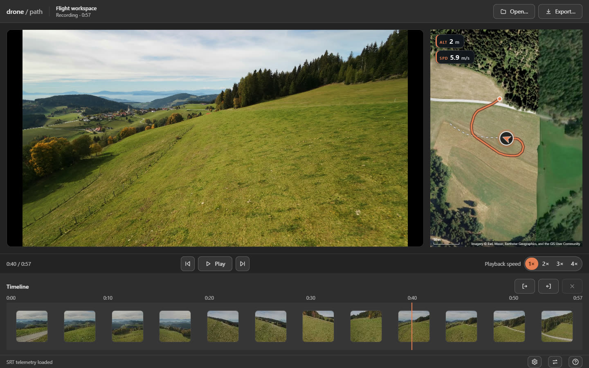

# Neo 2 Flightpath

This handy little tool allows you to render flight-path map videos
from DJI drone recordings (DJI Neo 2 and similar).

I wanted a tool to render the actual flight-path on a 2d map,
so that I can overlay it in the actual footage of my drone flight
videos.

Currently, it supports two main ways to acquire the geo-coordinates from
DJI's telemetry:

- if an `.SRT` sidecar is available, that will be used,
- otherwise it tries to parse the embedded `CAM` meta stream (DJI's protobuf format).

It is a CLI tool, since I plan to support agentic use cases.
Meaning, if an agent wants to use it to help you create flight-path videos,
that's all cool with me.

For us humans, there is a desktop app (see *Desktop app*): it opens a window
where you pick a recording and watch its flight path on the map in sync with
the footage.

## Quick start

```sh
# from GitHub
npx github:MrManny/neo2-flightpath "my-flight.mp4"

# from npm
npx neo2-flightpath "my-flight.mp4"

# topographic map, altitude + speed HUD
npx neo2-flightpath "my-flight.mp4" --style topo --hud heading,alt,speed
```

Output lands in the `out/` folder as `<basename>_map.mp4`; both the folder
and the name are configurable. This needs Node.js 24 or newer and
**ffmpeg + ffprobe** on `PATH`; all requirements and install options are in
[Getting started](docs/user/getting-started.md).

## Documentation

The user manual lives in [docs/user/](docs/user/README.md); the desktop app
ships the same pages as offline help. Highlights:

- [Getting started](docs/user/getting-started.md) — requirements, install options, and your first render.
- [Desktop app](docs/user/desktop-app.md) — loading a recording, reviewing a flight, and exporting video from the app.
- [Keyboard shortcuts](docs/user/keyboard-shortcuts.md) — every shortcut of the review player at a glance.
- [CLI usage](docs/user/cli.md) — inputs, examples, and example output.
- [CLI and config reference](docs/user/cli-reference.md) — every option and config key with its default.
- [Config file](docs/user/config-file.md) — where `.neo2flightpath.json` is found and how defaults apply.
- [Tiles and attribution](docs/user/tiles-and-attribution.md) — map sources, attribution, and tile caching.

## Desktop app

For reviewing flights without the terminal, grab the packaged desktop app
(Windows NSIS installer or portable exe, Linux AppImage) from
[GitHub Releases](https://github.com/MrManny/neo2-flightpath/releases), or run
`npm run build && npm run app` from a checkout.

The app shows the footage and the map overlay in a swappable
picture-in-picture layout on one shared timeline scrubber;
[the manual](docs/user/desktop-app.md) walks through loading a recording,
reviewing a flight, looping a passage, and exporting.



*The desktop app playing a recording: footage and map overlay in picture-in-picture,
with the flight trail, drone position and HUD chips on one shared timeline scrubber.*

## Feature requests

If you want or need specific features, feel free to open an issue in this
repository's issue tracker.
I plan to maintain this project for a good bit, and hopefully making it more
useful for people in the long run.

## License

MIT — see [LICENSE](LICENSE).
