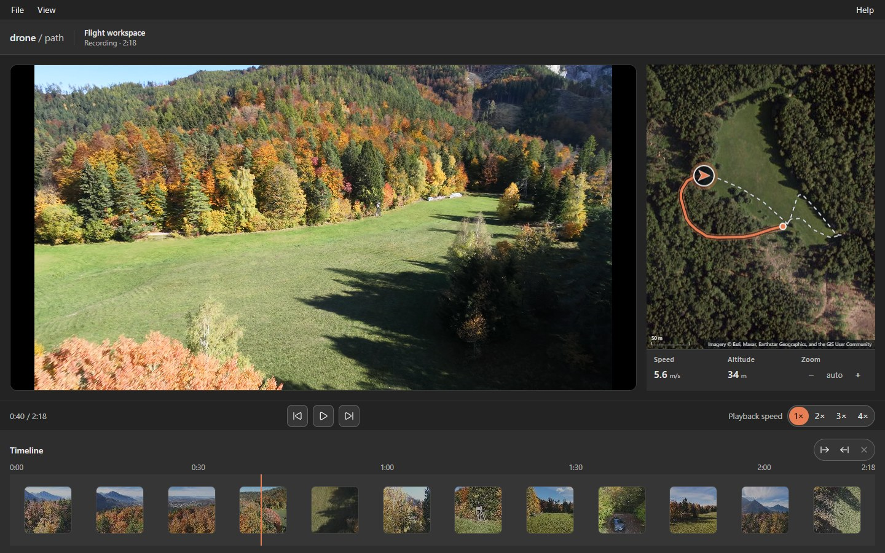

# Drone Path

This handy little tool renders flight-path map videos from DJI drone
recordings (DJI Neo 2 and similar): the actual flight path on a 2D map,
ready to overlay over the drone recording.

It reads geo-coordinates from DJI's telemetry in two ways:

- the embedded CAM meta (DVTM) stream (DJI's protobuf format) is used when
  the recording has one,
- otherwise an `.SRT` sidecar next to the recording is used.

It is a CLI tool first, so agents can drive it too — that's all cool with me.
For us humans, there is a [desktop app](docs/user/desktop-app.md): pick a
recording and watch its flight path on the map in sync as you play.

## Quick start

```sh
npx drone-path "my-flight.mp4"

# topographic map, altitude + speed HUD
npx drone-path "my-flight.mp4" --style topo --hud heading,alt,speed

# flight track file alongside the render (GPX, GeoJSON, KML/KMZ or the
# telemetry JSON document, chosen by the extension; one recording per run)
npx drone-path "my-flight.mp4" --track-out "my-flight.gpx"
```

Output lands in the `out/` folder as `<basename>_map.mp4`; both the folder
and the name are configurable. Requirements: Node.js 24 or 26 and
ffmpeg/ffprobe — bundled with the desktop app and the npm package,
overridable via `--ffmpeg`/`--ffprobe`, with a `PATH` fallback. All
requirements and install options are in
[Getting started](docs/user/getting-started.md).

### Scan a recording library

Run `drone-path archive scan <folder> --recurse --json` to index MP4 recordings locally and print the inventory as newline-delimited JSON. Rescans reuse unchanged clips. See the [CLI manual](docs/user/cli.md#scan-a-recording-library) for the record format and archive options.

Use `drone-path archive list --status offline --json` to find disconnected recordings or `drone-path archive near 46.62,14.31 --radius 250 --json` to find the closest pass in each matching clip. See the [CLI manual](docs/user/cli.md#query-the-recording-library) for filters and result formats.

Use `drone-path archive list --group-by flight` to see consecutive clips and split recordings grouped into inferred flights. Add `--include-gaze` to `archive near` to also search estimated DVTM camera footprints.

Use `drone-path archive export-map flights.html` for a standalone map or `drone-path archive export-tracks flights.gpx` for a combined track file. Add `--redact-launch <m>` to remove geometry around indexed launch and landing points before sharing.


## User manual

The user manual lives in [docs/user/](docs/user/README.md); the desktop app
ships the same pages as offline help. Highlights:

- [Getting started](docs/user/getting-started.md) — requirements, install options, and your first render.
- [Desktop app](docs/user/desktop-app.md) — loading a recording, reviewing a flight, exporting video, and saving telemetry JSON from the app.
- [Keyboard shortcuts](docs/user/keyboard-shortcuts.md) — every shortcut of the review player at a glance.
- [CLI usage](docs/user/cli.md) — inputs, examples, and example output.
- [CLI and config reference](docs/user/cli-reference.md) — every option and config key with its default.
- [Config file](docs/user/config-file.md) — where `.dronepath.json` is found and how defaults apply.
- [Tiles and attribution](docs/user/tiles-and-attribution.md) — map sources, attribution, and tile caching.

## Desktop app

For reviewing flights without the terminal, grab the packaged desktop app
(Windows NSIS installer or portable exe, Linux AppImage) from
[GitHub Releases](https://github.com/MrManny/drone-path/releases), or run
`npm run build && npm run app` from a checkout.

The app shows the recording and the synchronized flight map side by side —
togglable to a corner map overlay — on one shared timeline;
[the manual](docs/user/desktop-app.md) walks through loading a recording,
reviewing a flight, marking a passage, exporting, and saving the per-frame
telemetry JSON. The look and language settings carry over between launches.



*The desktop app playing a recording: the recording beside the synchronized
flight map, with the flight trail, drone position and the readout strip on one
shared timeline.*

## Feature requests

If you want or need specific features, feel free to open an issue in this
repository's issue tracker.

## Repository layout

Run `npm ci`, `npm run lint`, `npm test`, and `npm run build` from the
repository root. The workspaces share a single lockfile.

| Workspace | Owns |
| --- | --- |
| [`packages/core`](packages/core/) | Telemetry extraction, frame ranges, and tool discovery |
| [`packages/engine`](packages/engine/) | Configuration, rendering, and map tiles |
| [`packages/cli`](packages/cli/) | The `drone-path` command and CLI API |
| [`packages/tooling`](packages/tooling/) | Manual, schema, build identity, and localization generators |
| [`apps/desktop`](apps/desktop/) | Electron shell, Next.js UI, and desktop packaging |

To run the CLI from a checkout after `npm ci`:

```sh
npm run build:cli
node packages/cli/bin/drone-path.mjs "my-flight.mp4"
```

## Releasing

`npm run changeset:version` folds pending changesets and updates the lockfile.
The three npm packages and the desktop app share one version. Update the root
changelog in the release PR and use the matching `v<version>` GitHub release tag.
From an installed, built checkout, preview the release without publishing with
`node scripts/release-npm.mjs dry-run v<version>`.

A published GitHub release runs the tag and quality checks, then publishes
`drone-path-core`, `drone-path-engine`, and `drone-path` to npm in that order.
Independent jobs attach the desktop installers, AppImage, and auto-update
metadata to the same release. GitHub prereleases publish to npm under the
`next` dist-tag instead of `latest`.

Reserve the release's exact package versions for GitHub Actions. To publish
the first release, set the repository's `NPM_TOKEN` secret to a granular token
authorized to create the new public package names and publish all packages in
the release. The workflow uses `--provenance` with the token.

For a manual bootstrap, use npm credentials that can create the new names.
Publish a distinct, earlier prerelease for each new name under a non-default
dist-tag such as `bootstrap` (`npm publish --workspace <name> --access public --tag bootstrap`).
npm package versions are immutable, so the workflow needs the exact release
versions to be unused.

Once each package exists, configure its
[trusted publisher](https://docs.npmjs.com/trusted-publishers/) on npm
with owner `MrManny`, repository `drone-path`, workflow `release.yml`, and
permission for direct publishing. Remove `NPM_TOKEN` when all three are
configured so subsequent releases use token-free trusted publishing.

After a partial publish, check the package versions on npm and re-run failed
jobs in GitHub Actions. Each package has its own job, so completed package jobs
keep their successful result and dependent jobs resume in order.

## License

MIT — see [LICENSE](LICENSE).
