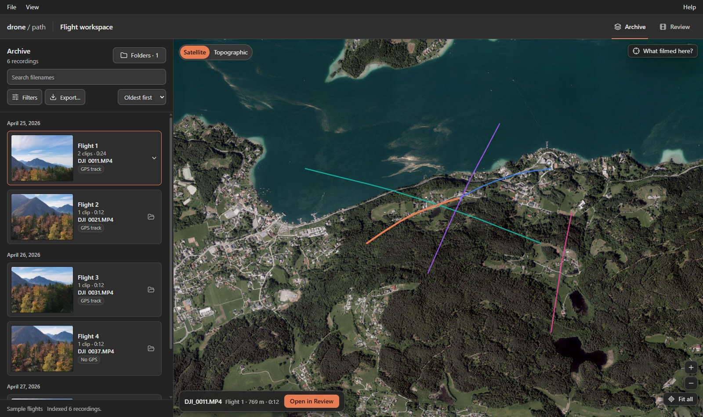
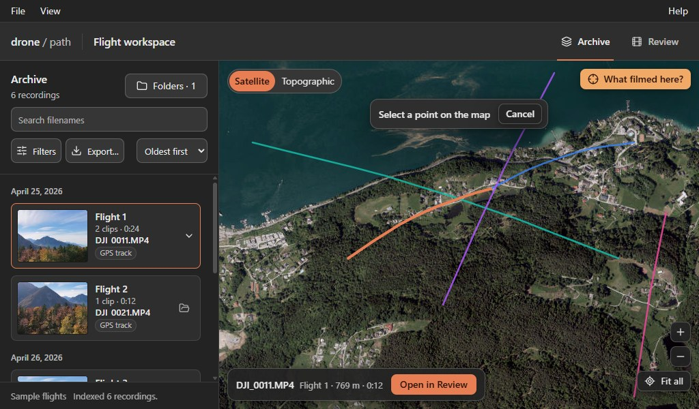
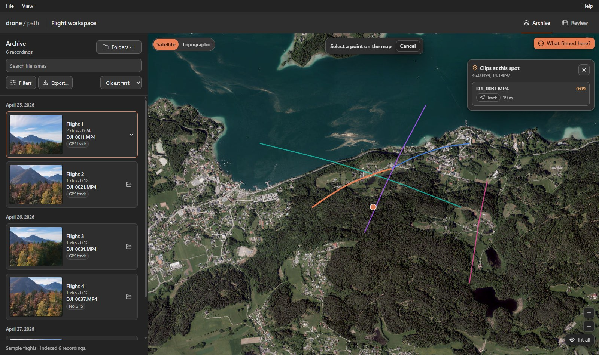

# Archive workspace

The Archive workspace lets you index folders of DJI drone recordings, browse inferred flights on a single map, search for clips that flew near or filmed a spot, filter by telemetry and shot type, and export combined tracks or interactive maps.

## Adding, rescanning, and removing watched folders

When no watched folders are configured yet, launching the app opens the empty [Review workspace](desktop-app.md#loading-a-recording). To start an archive:

1. Choose **File → Open folder…** from the [menu bar](desktop-app.md#the-menu-bar).
2. Pick a folder containing your drone recordings.

The app switches to **Archive** mode, remembers the folder, and scans it recursively in the background. When watched folders already exist at launch, the app opens directly into **Archive** mode and runs a background rescan.

Click **Folders** above the Archive list to manage the watched folders:

- **Add folder…** adds another watched folder and scans it.
- **Rescan** re-indexes all watched folders. It reuses unchanged recordings and `.SRT` sidecars, retries previously failed clips, and refreshes clip availability.
- **Cancel scan** replaces **Rescan** during a scan and keeps clips that are already indexed.
- **Remove** stops watching a folder and deletes its records from the archive index. Your video files stay on disk.

The bottom of the sidebar shows scan progress or the latest scan result. The index uses the same per-user SQLite database as `drone-path archive` (see [Spatial archive](cli.md#spatial-archive)).

## Browsing and searching flights

The sidebar groups thumbnail cards by the date each flight started (UTC). Flights without a recording date appear under **Undated**. Use **Oldest first** or **Newest first** above the list to change the order.

Type part of a filename in **Search filenames** to narrow the list. Search ignores case and works alongside **Filters**. A flight appears if one or more of its clips match. Expand the card to see which clips matched. Filename search only affects the sidebar. The map and exports use the Archive filters.

A single-clip card opens the recording in Review. Expand a multi-clip card to open its individual clips or reveal them in your file manager. Offline clips stay visible with opening disabled. When you select a track on the map, Archive expands its flight and scrolls to the clip if the flight is visible in the sidebar.

## Switching between Archive and Review

Once at least one watched folder exists (or while in Archive mode), a flush **Archive | Review** tab strip sits at the right end of the workspace header. When focused, use `Left` / `Right`, `Home`, or `End` to move between the two tabs:

- Clicking any online recording in the clip list, clicking **Open in Review** on the map readout, or picking a match from **What filmed here?** opens that recording in **Review** mode at auto-fit zoom.
- Switching back to **Archive** preserves your watched folders, active filters, selected clip, map viewport, and any open **What filmed here?** query results in memory.
- Switching back to **Review** returns to the currently loaded recording and playback state without reloading it.

## Browsing the multi-flight map

The right-hand pane displays all matching GPS tracks on a Canvas-rendered map colored by inferred flight. While basemap tiles load, a quiet `Preparing map…` indicator appears near the top of the map:

- **Clustering:** At wider zoom levels (`zoom` 11 and below), nearby clips group into numbered coral clusters. Hover a cluster to see how many recordings it holds, and click it to zoom in until the individual flight tracks appear.
- **Selection & readout:** Hovering or clicking a track highlights it and shows its filename, flight number, distance, and duration in the bottom-left readout bar, along with an **Open in Review** button for the selected online clip.
- **Map style & navigation:** Switch between **Satellite** and **Topographic** basemaps in the top-left toolbar (shared with [Map appearance](desktop-app.md#map-appearance) in Review). Use **Fit all**, `+`, and `−` at the bottom right to frame all matching tracks or step zoom levels. See [Tiles and attribution](tiles-and-attribution.md) for map sources and tile caching.
- **Viewport sync:** Panning or zooming updates the active map bounds automatically when **Only in map view** is enabled in the filter rail.

*At the minimum 1024 × 600 window size, the search prompt moves below the top map controls.*

## Point-in-view search ("What filmed here?")

Use point-in-view search to find every recording that flew near a coordinate or pointed its camera at that spot:

1. Click **What filmed here?** at the top right of the map.
2. When **Select a point on the map** appears, click a location. Click **Cancel** to exit search mode.

Clicking a flight track also searches that location.

The **Clips at this spot** popover lists the clicked coordinates and ranked matches:

- **Camera view** — clips with embedded DVTM telemetry whose estimated ground camera footprint covers the spot (`0 m`).
- **Track** — clips whose GPS track passed within the zoom-scaled search radius (between `50 m` and `500 m`), sorted by closest distance.

Each match shows the filename, the clip-relative timestamp (`tSec`), its match type badge, and its distance from the clicked point. Click any online match to open that recording in **Review** and jump straight to that second. Press `Esc`, click the close button, or click **Dismiss** (when no clips matched) to close the popover.

*Point-in-view search: **What filmed here?** shows ranked clip matches for the clicked spot in the **Clips at this spot** popover.*

## Filtering recordings

Click **Filters** above the recording list to expand or collapse the filter rail. When filters are active, the button displays the active filter count.

| Filter | Effect |
| --- | --- |
| **From date** / **To date** | Matches recordings whose zoned `cameraCreationTime` falls within the chosen inclusive start and inclusive end calendar dates (UTC). |
| **Folder** | Restricts results to clips inside one watched folder. |
| **Flight** | Restricts results to one inferred flight. |
| **Min distance** | Requires at least the entered GPS track length in meters (`m`). |
| **Shot type** | Matches clips containing a kinematic shot segment of the selected type (`Takeoff`, `Landing`, `Hover`, `Smooth glide`, `Orbit`, `Gimbal reveal`, or `Reposition`). |
| **Min smoothness** | Matches clips with a shot segment at or above the slider's smoothness score (`0.00` to `1.00`, or **Any** at `0`). |
| **Only in map view** | Keeps only clips whose bounding box intersects the current map viewport. |

Click **Clear filters** to reset every filter back to its default.

## Thumbnails, Reveal in folder, and archive exports

Each flight group header shows the flight number, clip count, and total flight duration. Each 2-line clip row shows a lazy-loaded JPEG poster thumbnail extracted from the video (falling back to a film icon when unavailable), a readable filename (with the full file path in a hover tooltip), tabular duration and track distance, status badges (`No GPS`, `Offline`, or `Unreadable`) when applicable, and a **Reveal in folder** icon button beside online clips to highlight the file in your system file manager.

Click **Export…** above the recording list to open **Export archive**. If filters are active, the export includes only the recordings matching those filters.

- **Format:** Choose **GPX track (.gpx)**, **GeoJSON track (.geojson)**, **KML track (.kml)**, **KMZ archive (.kmz)**, or **Interactive HTML map (.html)**.
- **Redact launch area:** Trims geometry within the entered positive radius in meters (default `500 m`) around each exported flight's first and last indexed GPS fixes. For HTML maps, enabling launch redaction also omits camera footprints and clip labels.
- **HTML map options:** When **Interactive HTML map (.html)** is selected, you can toggle **Include camera gaze footprints** (disabled while launch redaction is on) and **Offline map (no online basemaps)** to block external tile requests.

After choosing a destination and completing the export, click **Reveal in folder** to open the exported file's location or **Done** to close the dialog. See [Export the recording library](cli.md#export-the-recording-library) for full format and redaction policy details.

## Offline drives and missing clips

If a watched folder resides on a disconnected external drive or SD card, or if indexed recordings were moved or deleted:

- Missing recordings stay in the archive marked **Offline**, appear as dashed tracks on the map, and still appear in **What filmed here?** matches so your flight history stays searchable.
- Watched folders whose files are missing or unreachable show an **Offline** badge and dim the folder name when expanded.
- Opening an offline recording or using **Reveal in folder** is disabled until you reconnect the drive and click **Rescan**.

To clean up records for files you permanently deleted or moved, open **Folders**, click **Remove missing clips…**, and confirm **Remove missing clips** in the dialog. This removes only the cached flight tracks and telemetry statistics for offline clips from the archive database — video files on disk are never touched.

## Keyboard navigation

See [Keyboard shortcuts](keyboard-shortcuts.md#archive-workspace) for switching the **Archive | Review** header tabs with `Left` / `Right` and `Home` / `End`, moving through the recording list with `Up` / `Down`, and dismissing the point-query popover with `Esc`.
