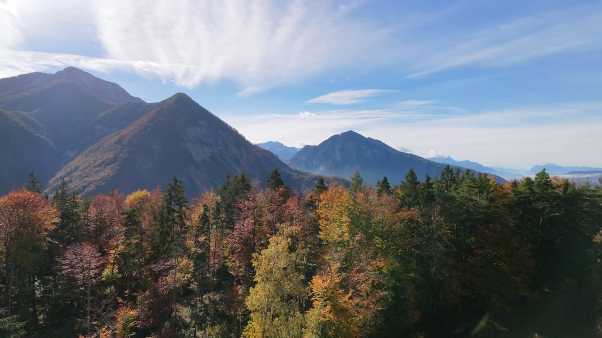
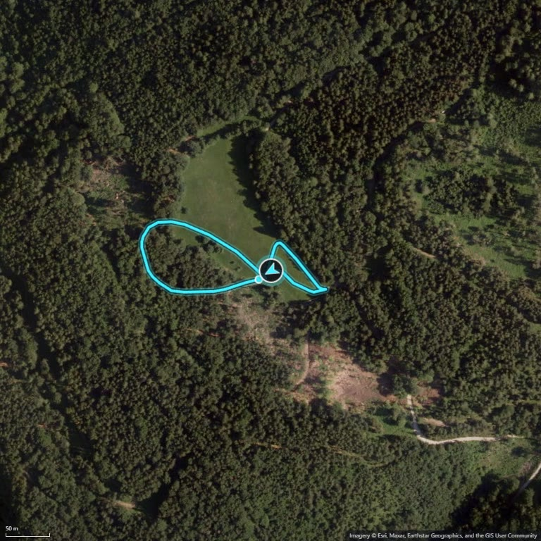
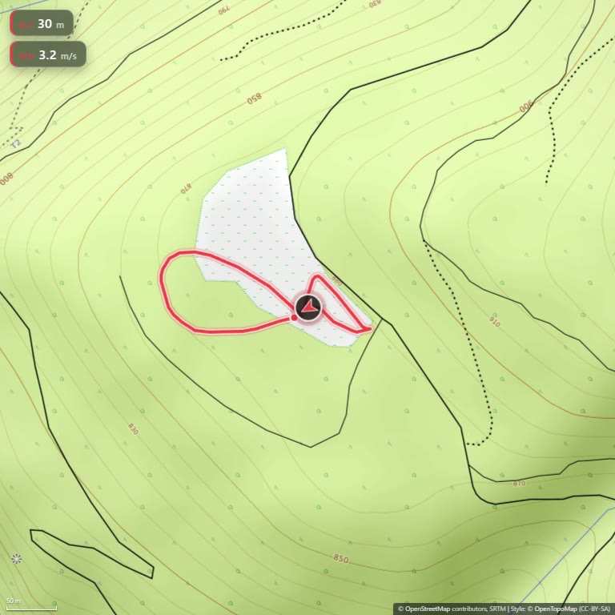

# CLI usage

## Syntax

```sh
neo2-flightpath <inputs...> [options]
```

`<inputs...>` are `.mp4` files and/or folders (folders are scanned for `*.mp4`, optionally with `--recurse`). Every recording is processed independently.

## Examples

```sh
# quick conversion: one video, all default settings
neo2-flightpath "flight.mp4"

# full flight-path video: topographic map and the complete HUD
# (heading arrow + altitude + speed chips)
neo2-flightpath "flight.mp4" --style topo --hud heading,alt,speed
```

## Example output

All frames below are from the same recording:



*Source footage — the flight recording the examples below are rendered from.*



*Default settings (first two commands): satellite map, growing trail and heading arrow.*



*`--style topo --hud heading,alt,speed` (third command): topographic map with heading, altitude and speed chips.*

The heading arrow shows drone yaw when the `CAM meta` stream provides it, otherwise the yaw is computed from the track.

## Options and reference

Run `npx neo2-flightpath --help` for the built-in overview. The complete table of options and config keys lives in [CLI and config reference](cli-reference.md); persistent settings are covered in [Config file](config-file.md).
