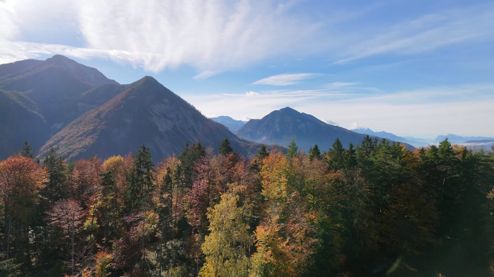
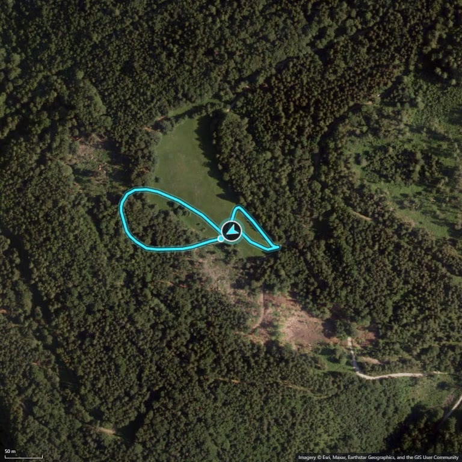
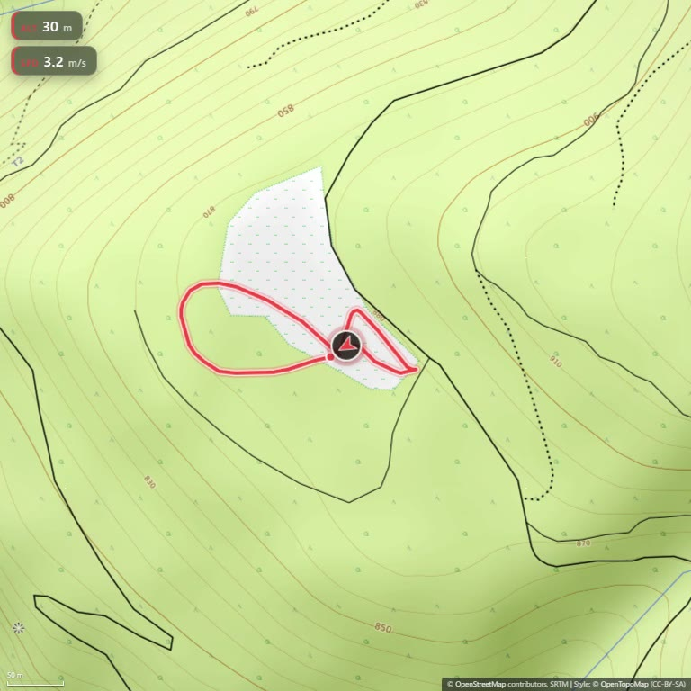

# CLI usage

Use the `drone-path` CLI to render flight-path map videos, export tracks and keyframes, index and query a local recording library, export NLE markers, or run an MCP server for AI agents.

## Quickstart

### Render map overlays and flight tracks

```sh
# render one recording with default settings (writes out/flight_map.mp4)
drone-path "flight.mp4"

# topographic map with heading, altitude, and speed HUD chips
drone-path "flight.mp4" --style topo --hud heading,alt,speed

# custom trail color (RGB or RGBA hex; leading # is optional)
drone-path "flight.mp4" --trail-color e63946
drone-path "flight.mp4" --style topo --trail-color "#e63946cc"

# export a GPX flight track alongside the rendered video
drone-path "flight.mp4" --track-out "flight.gpx"
```

### Extract targeted keyframes

```sh
# extract JPEG keyframes at 2.5s and frame 90, scaled to max 640px wide, as JSON
drone-path extract-frame "flight.mp4" --at 2.5,f90 --max-width 640 --json
```

### Scan and query the spatial archive

```sh
# index a folder of recordings recursively into the local archive
drone-path archive scan /path/to/footage --recurse --json

# list all indexed clips
drone-path archive list

# find smooth gliding shots ordered by smoothness score
drone-path archive list --segment-type smooth-glide --min-smoothness 0.8 --json

# group matching clips into inferred flights
drone-path archive list --group-by flight

# find clips passing within 250 m of a coordinate or seeing it in camera view
drone-path archive near 46.62,14.31 --radius 250 --include-gaze
```

### Export NLE markers, maps, and combined tracks

```sh
# export smooth-glide shot segments as DaVinci Resolve CSV markers
drone-path archive export-markers shots.csv --segment-type smooth-glide

# export a standalone HTML map with camera ground footprints
drone-path archive export-map flights.html --include-gaze

# export combined GeoJSON tracks for online clips
drone-path archive export-tracks flights.geojson --status online
```

### Start the stdio MCP server

```sh
# expose archive, telemetry, keyframe, marker, and render tools over stdio
drone-path mcp --allow-root /path/to/footage
```

## Example output

All frames below are from the same recording:



*The source recording the examples below are rendered from.*



*Default settings (`drone-path "flight.mp4"`): satellite map, growing trail, and heading arrow.*



*`--style topo --hud heading,alt,speed`: topographic map with heading, altitude, and speed chips.*

The heading arrow shows drone yaw when the CAM meta (DVTM) stream provides it; otherwise the yaw is computed from the track.

## Render flight-path videos

```sh
drone-path <inputs...> [options]
```

`<inputs...>` are `.mp4` files and/or folders (folders are scanned for `*.mp4`, optionally with `--recurse`). Every recording is processed independently. By default, output lands in `out/` as `<basename>_map.mp4`.

| Common option | Purpose |
| --- | --- |
| `--out-dir <dir>`, `--out-suffix <suffix>` | Output folder (`out`) and filename suffix (`_map`). |
| `--style <name>`, `--trail-color <hex>` | Map look (`satellite` or `topo`) and RGB/RGBA trail color. |
| `--view <mode>`, `--zoom <n>`, `--zoom-out <n>` | Camera mode (`follow` or `overview`) and zoom framing. |
| `--hud <list>` | Comma-separated HUD chips (`heading,alt,speed`) or `none`. |
| `--codec <name>`, `--quality <level>`, `--preset <name>` | Video encoder (`h264`/`h265`), quality, and speed preset. |
| `--track-out <file>` | Write a `.gpx`, `.geojson`, `.kml`, `.kmz`, or `.json` file beside the render. |
| `--recurse`, `--skip-existing`, `--json`, `-q, --quiet` | Recursive input discovery, incremental skips, NDJSON summaries, quiet stderr. |
| `--config <path>` | Load a specific `.dronepath.json` config file. |

Run `npx drone-path --help` for the built-in overview. The complete table of options and config keys lives in [CLI and config reference](cli-reference.md); persistent settings and precedence are covered in [Config file](config-file.md).

## Flight track export

`--track-out <file>` writes the decoded flight track alongside the render, in the format the file extension selects:

| Extension | Format | Opens in |
| --- | --- | --- |
| `.gpx` | GPX 1.1 track | Google Earth, QGIS, most map tools |
| `.geojson` | GeoJSON `MultiLineString` feature | QGIS, web maps |
| `.kml` | KML 2.2 | Google Earth |
| `.kmz` | Zipped KML (the same document inside a `doc.kml`) | Google Earth |
| `.json` | The telemetry document (see below) | This toolchain |

Any other extension is an error — there is no silent fallback. The run must cover a single recording; skipped recordings (`--skip-existing`) write no file. The export always covers the whole recording: a frame range applied to the render limits only the video, never the track file. For the same recording and range the CLI and the desktop app write byte-identical files, and reruns of the same input write byte-identical files (including `.kmz`).

Field policy — what the track formats carry:

- **Vertices sit at decoded GPS fixes** — one per fix, never interpolated or bridged. A telemetry gap breaks the line into segments: one `<trkseg>` per segment in GPX, one line per segment in the GeoJSON `MultiLineString`, one placemark per segment in KML.
- **Altitude is the absolute/GPS altitude in meters above mean sea level** (the CAM-meta `AbsoluteAltitude`, falling back to the GPS altitude; the relative take-off altitude is never used). It appears as GPX `<ele>`, as the third coordinate of every GeoJSON position, and in every KML coordinate. Where a vertex has no altitude, GPX omits `<ele>`, GeoJSON writes a two-element position, and KML writes `0` and clamps that placemark to the ground (`clampToGround`); segments with altitude at every vertex keep `absolute` altitude.
- **Times appear only where the source carries trustworthy UTC** — never invented. Today no DJI source does: the CAM-meta device timestamp counts milliseconds since power-up and the `.SRT` cue wall-clock has no time zone, so exports carry no times. When a recording does carry trustworthy UTC, GPX adds `<time>`, GeoJSON adds `coordinateProperties.times` (the QGIS convention), and KML switches from a plain `LineString` placemark to a timed `gx:Track` per segment — the Google Earth flythrough.
- **Per-vertex speed and heading are out of scope**; the `.json` document stays the rich-data format.

## Telemetry JSON export

`--track-out <file>.json` writes one JSON document with the raw per-frame telemetry alongside the render. The document contains:

- a schema header (declared proto schema, source, heading mode, frame count, gimbal device constants);
- exactly one record per source frame with the time, position, altitude, body and gimbal attitude, heading, and camera exposure values the telemetry source decoded.

Values the source does not carry are omitted from the record — absent keys, never `null` — and zero-valued attitudes the wire skipped (proto3 zero-omission) are exported as `0.0`. The one exception is `headingDeg`: it keeps the same back-filled heading the map arrow renders, and `headingSource` says whether the heading came from drone yaw or was derived from the track.

The document follows the checked-in `docs/telemetry-json.schema.json`; `SensorTemperature` and the semantics-undecoded DVTM fields are deliberately excluded. The run must cover a single recording; skipped recordings (`--skip-existing`) write no document. The document always covers the whole recording: a frame range applied to the render limits only the video, never the exported telemetry.

`--telemetry-json <file>` is a deprecated alias of `--track-out <file>.json`: it keeps writing the same document byte-for-byte and warns that it will be removed in a future version. Both spellings normalize to one option, so passing both at once is an error — on the command line, in the config file, or across both.

**`--json` is not `--track-out data.json`:** `--json` prints one NDJSON summary line per recording on stdout (for scripting), while `--track-out data.json` writes the telemetry document to a file. They are separate options and can be combined.

## Extract keyframes

```sh
drone-path extract-frame <video> --at <specs> [options]
```

Extracts targeted JPEG keyframes and nearest telemetry snapshots from a single recording without rendering a map video.

| Option | Description |
| --- | --- |
| `--at <specs>` | Required comma-separated selectors: timestamps in seconds (`2.5`, `2.5s`) or 0-based frames (`f90`, `frame:90`). |
| `--max-width <px>` | Maximum output width in pixels, preserving aspect ratio (with even JPEG height). |
| `--out-dir <dir>` | Output directory (defaults to the source video's directory). |
| `--ffmpeg <path>` | Path to the `ffmpeg` executable. |
| `--ffprobe <path>` | Path to the `ffprobe` executable. |
| `--json` | Write the extracted keyframes JSON array to stdout. |

- **Selectors & seeking:** Time selectors must fall within `[0, duration]` and frame selectors within `[0, frames - 1]`. Extraction uses fast input seeking (`-ss` before `-i`) so preceding GOPs do not need to be decoded, and writes `<stem>_f<frame>_<ms>ms.jpg` files.
- **Output & telemetry snapshots:** Without `--json`, each extracted frame prints `<path> (frame <n>, <t>s, <w>x<h>)` on stdout and a summary count on stderr. Each JSON entry includes `path`, `tSec`, `frame`, `width`, `height`, and a `telemetry` snapshot (`lat`, `lon`, `altRelM`, `altAbsM`, `speedMps`, `headingDeg`, `gimbalPitchDeg`, `gimbalYawDeg`, `iso`, `shutterTime`, or `null` if the recording has no telemetry).

## Spatial archive

### Scan a recording library

```sh
drone-path archive scan <dirs...> [options]
```

| Option | Description |
| --- | --- |
| `--recurse` | Include subfolders when scanning `<dirs...>`. |
| `--prune` | Remove missing recordings in the scanned folders from the index. |
| `--archive-db <path>` | Override the per-user SQLite database path. |
| `--json` | Write one JSON record per clip to stdout in path order (NDJSON). |

Drone Path skips non-MP4 files and generated `*_map.mp4` overlays; progress goes to stderr.

- **Database locations:** The archive uses a per-user SQLite database at `%LOCALAPPDATA%/drone-path/archive.sqlite` on Windows, `~/Library/Application Support/drone-path/archive.sqlite` on macOS, and `$XDG_DATA_HOME/drone-path/archive.sqlite` on Linux (`~/.local/share/drone-path/archive.sqlite` by default).
- **Incremental rescans & availability:** Rescans reuse records when the recording and its `.SRT` sidecar are unchanged and retry clips that previously had a scan error. When a clip is missing from a scanned folder, its record stays in the database as `offline`; reconnecting the drive and scanning the same folder marks it `online` again, while `--prune` removes missing clips in the scanned folders.
- **Indexed data:** Each record reports the canonical path, file size and modification time, video metadata, and a status of `ok`, `no-telemetry`, `no-gps`, or `error`. If present, `cameraCreationTime` holds the original, unverified camera tag. For clips with GPS fixes, the index stores bounding boxes, overview tracks (up to 60 vertices), detail tracks (up to 500 vertices), ~1-second GPS samples (with clip-relative `tSec`), estimated camera footprints (for DVTM clips), and kinematic shot segments.

### Query the recording library

```sh
drone-path archive list [options]
drone-path archive near <lat,lon> [options]
```

Options for `drone-path archive list`:

| Option | Description |
| --- | --- |
| `--in-bbox <s,w,n,e>` | Filter clips whose bounding box touches the inclusive viewport (west > east crosses the antimeridian). |
| `--after <date>` | Camera tag is at or after `<date>` (inclusive). |
| `--before <date>` | Camera tag is earlier than `<date>` (exclusive). |
| `--min-dist <m>` | Minimum GPS track distance in meters. |
| `--status <state>` | Availability filter: `online` or `offline`. |
| `--segment-type <type>` | Match kinematic shot type (`takeoff`, `landing`, `hover`, `smooth-glide`, `orbit`, `gimbal-reveal`, or `reposition`). |
| `--min-smoothness <score>` | Match shot segments with smoothness score at or above `<score>` (`0` to `1`). |
| `--group-by flight` | Group matching clips into inferred flights in recording order. |
| `--archive-db <path>` | Override the per-user SQLite database path. |
| `--json` | Write a JSON array to stdout (`[]` when nothing matches). |

Options for `drone-path archive near <lat,lon>`:

| Option | Description |
| --- | --- |
| `--radius <m>` | Search radius in meters (default: `100`). |
| `--include-gaze` | Also match clips whose estimated camera ground footprint contains the point. |
| `--archive-db <path>` | Override the per-user SQLite database path. |
| `--json` | Write a JSON array to stdout (`[]` when nothing matches). |

- **Date bounds:** `--after` and `--before` accept `YYYY-MM-DD` at midnight UTC or an ISO timestamp with an explicit time zone. They compare `cameraCreationTime` only when the tag includes a time zone; file modification times and untagged local camera timestamps do not participate.
- **Flight grouping:** `--group-by flight` infers flights from consecutive DJI clip numbers in the same folder, zoned camera tags, and nearby GPS endpoints (gaps over 45 seconds start a new flight; clips near the 4 GB split limit link when time and position are continuous). Grouped JSON returns `{ flightId, clips }` entries where each clip includes `splitFromKey` (the predecessor's canonical archive path key, lowercase on Windows, or `null`).
- **Kinematic shot segments:** Without `--group-by flight`, passing `--segment-type` or `--min-smoothness` switches `archive list` from whole clips to ranked shot segments ordered by smoothness score (`0` to `1`), reporting shot type, `startSec`–`endSec`, smoothness, and exposure stability.
- **Spatial proximity & camera footprints:** `archive near` accepts negative coordinates such as `-33.86,151.21`, includes offline clips, and sorts hits by closest distance. Track matches report `matchType: "track"` with `tSec` interpolated within the same continuous GPS segment. With `--include-gaze`, clips whose estimated DVTM ground footprint contains the point return `matchType: "gaze"` with `distanceM: 0` and the first matching sampled frame's `tSec` (~1 footprint/second, 75° horizontal × 50° vertical FOV over flat ground using NED gimbal yaw; terrain, zoom, and lens crop are not modeled, and SRT-only clips return track matches only). Rescan previously indexed DVTM clips with source files available to populate footprints and shot segments.

### Export the recording library

```sh
drone-path archive export-markers <out> [options]
drone-path archive export-map <out.html> [options]
drone-path archive export-tracks <out> [options]
```

| Option | Commands | Description |
| --- | --- | --- |
| `--in-bbox`, `--after`, `--before`, `--min-dist`, `--status`, `--segment-type`, `--min-smoothness` | All three | Same clip and shot filters as `archive list`. |
| `--archive-db <path>` | All three | Override the per-user SQLite database path. |
| `--redact-launch <m>` | `export-map`, `export-tracks` | Remove geometry within `<m>` meters of each exported flight's first and last indexed GPS fixes. |
| `--include-gaze` | `export-map` | Include estimated camera ground footprints in the HTML map. |

- **NLE markers (`export-markers`):** Writes DaVinci Resolve CSV (`.csv`) or Final Cut Pro XML 1.10 (`.fcpxml`) markers from matching indexed shot segments. DaVinci Resolve CSV writes SMPTE timecodes (`#,Clip Name,In,Out,Duration,Marker Color,Marker Name,Notes`) with formula-injection escaping; FCPXML 1.10 writes `<asset-clip>` entries with `<marker>` tags, asset `file://` URLs, and rational frame durations.
- **HTML maps (`export-map`):** Writes a standalone `.html` file with the selected geometry colored by inferred flight. The map opens with Esri imagery. Use the layer picker to switch to OpenTopoMap or select **No basemap**. The browser requests tiles from the selected provider when viewing the map. Tracks and any exported camera footprints remain visible offline.
- **Combined tracks (`export-tracks`):** Writes `.gpx`, `.geojson`, `.kml`, or `.kmz`, preserving flight groups and segment boundaries and splitting tracks at the antimeridian. Because the archive stores simplified tracks and clip-relative sample times, exported tracks omit absolute altitudes and UTC timestamps.
- **Launch redaction (`--redact-launch <m>`):** Uses each flight's full indexed endpoints even when filters exclude its first or last clip. A positive radius also omits camera footprints and clip labels from HTML maps. The saved archive index is unchanged; if a recording started after takeoff or stopped before landing, remaining route geometry may still reveal the flight area.

## MCP server

```sh
drone-path mcp --allow-root <dir...> [--archive-db <path>]
```

Starts a stdio JSON-RPC 2.0 Model Context Protocol (MCP) server over `stdin` and `stdout` (all diagnostics go to `stderr`).

| Option / env var | Requirement | Description |
| --- | --- | --- |
| `--allow-root <dir...>` | Required | One or more existing directories restricting all file and folder tool inputs and outputs. |
| `--archive-db <path>` | Optional | Override the default per-user archive SQLite database path. |
| `DRONE_PATH_MCP_ALLOW_OVERWRITE` | Env var (`1` or `true`) | Allows `export_markers` and `render_map_video` to overwrite existing output files (refused by default). |

- **Path boundaries & safety:** Every allowed root is resolved canonically via realpath, and every input or output path argument (including discovered clips and planned render outputs) is verified against those roots after resolving symlinks and `..` segments. Archive query tools filter results to clips inside the allowed roots, tools cannot overwrite the archive SQLite database (or its `-wal`, `-shm`, and `-journal` files), `export_markers` and `render_map_video` refuse to overwrite existing output files unless `DRONE_PATH_MCP_ALLOW_OVERWRITE=1` (or `true`), `render_map_video` caps each call to at most 10 recordings, and MCP logs redact absolute filesystem paths.

| Tool | Purpose | Key arguments |
| --- | --- | --- |
| `archive_scan` | Index MP4 folders into the archive database | `dirs`, `recurse?`, `prune?` |
| `archive_list_clips` | List matching indexed clips | `bbox?`, `after?`/`afterMs?`, `before?`/`beforeMs?`, `minDistanceM?`, `availability?`, `segmentType?`, `minSmoothness?` |
| `archive_list_flights` | List matching clips grouped into inferred flights | Same filter fields as `archive_list_clips` |
| `archive_find_at_point` | Find clips passing near or viewing a coordinate | `lat`, `lon`, `radiusM?`, `includeGaze?` |
| `archive_list_segments` | List matching kinematic shot segments ordered by smoothness | Same filter fields as `archive_list_clips` |
| `clip_get_telemetry` | Probe a clip and return telemetry summary, shot segments, and sampled track records | `videoPath`, `includeSamples?`, `maxSamples?` (1–2000, default 100) |
| `clip_extract_keyframes` | Extract JPEG keyframes and telemetry snapshots | `videoPath`, `at` (string or array), `maxWidth?`, `outDir?` |
| `export_markers` | Write DaVinci Resolve CSV or FCPXML markers from explicit ranges or archive filters | `outputPath`, `ranges?` or `filters?` |
| `render_map_video` | Render flight-path map overlay videos (and optional track export) | `inputs`, `outDir?`, `outSuffix?`, `width?`, `height?`, `style?`, `view?`/`camera?`, `zoom?`, `zoomOut?`, `introSec?`, `outroSec?`, `trailColor?`, `hud?`, `codec?`, `quality?`, `preset?`, `trackOut?`, `skipExisting?`, `recurse?`, `frameStart?`, `frameEnd?` |
