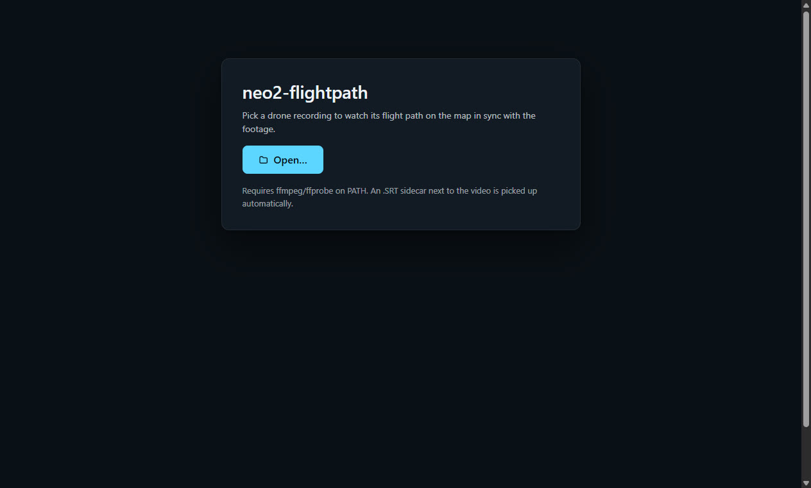
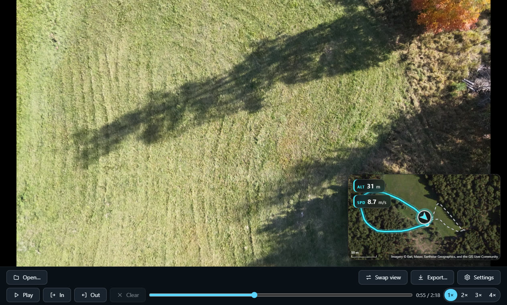
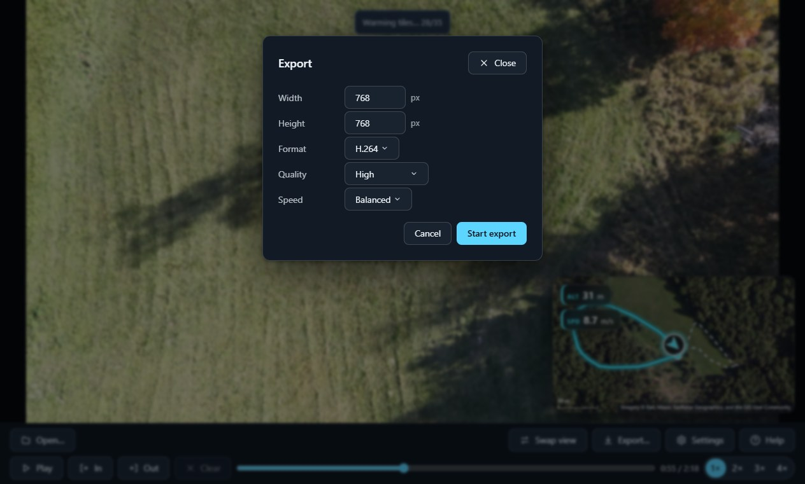

# Desktop app

## Getting the app

Grab the packaged desktop app (Windows NSIS installer or portable exe, Linux AppImage) from [GitHub Releases](https://github.com/MrManny/neo2-flightpath/releases), or run `npm run build && npm run app` from a checkout.

## Loading a recording

Launch the app and pick a drone video; the **Open…** dialog starts in the folder the last recording was opened from. The player opens as soon as the map tiles around the drone at the first frame are warm; the remaining tiles the map can show keep loading in the background while a small "Warming tiles…" hint over the player counts them, and playback is ready right away. Changing the map style, zoom or view in [Settings](#settings) starts loading the tiles for the new view instead.

*The start screen: pick a recording to begin.*

## Reviewing a flight

The screen shows the footage and the map overlay in a swappable picture-in-picture layout on one shared timeline scrubber. Play, pause and scrub keep the video frame, trail, drone position and HUD chips on the same frame; the map fills its pane at any window size, while the export framing follows `--width` / `--height` as usual. Every playback control has a [keyboard shortcut](keyboard-shortcuts.md).

*Footage and map overlay in picture-in-picture, with the flight trail, drone position and HUD chips on one shared timeline scrubber.*

## Looping a passage

Press `I` to mark the loop in point and `O` the out point; the passage between them plays on repeat until you clear the loop with `Esc`.

*Loop in and out points marked on the timeline; the passage between them plays on repeat.*

## Export

The **Export…** button in the control bar renders the recording with the look you see in the preview. Choose *Full recording* or the *In–Out segment* (set the loop points with `I` / `O` first; once a loop is set the segment comes preselected), set the output size and the encoding — format (H.264 or H.265), quality (*Near-lossless* down to *Low*) and speed — press **Start export**, and pick the destination file. The app remembers the encoding choices between launches like the look settings, and the output size while the recording is open.

*The Export dialog: render the full recording or just the In–Out segment, at the size and encoding you pick.*

## Settings

The **Settings** panel controls the look of the render: map style (satellite or topographic), view mode (follow keeps the drone centered with the map sliding under it; overview shows the whole track at once), zoom and zoom-out levels, the intro and outro zoom transitions, and the HUD chips (heading, altitude and speed — altitude and speed are off by default). The app remembers these settings between launches: the next launch starts with the last-used look, and a fresh install — or settings the app cannot read — starts at the defaults.

## Updates

Packaged builds update themselves: when a newer [release](https://github.com/MrManny/neo2-flightpath/releases) exists, the app downloads it in the background and asks once whether to **Restart now** into it or keep working with **Later**; the update then installs when you quit.

## Help

The **Help** button on the start screen and in the control bar opens this manual inside the app. It is bundled with the app, so it works offline.

## Notes

The app embeds Chromium and needs no system browser, but it does need **ffmpeg + ffprobe** on `PATH` like the CLI. Map tiles need internet on the first run and are cached like CLI tiles (see [Tiles and attribution](tiles-and-attribution.md)). One recording at a time — batch rendering stays a CLI concern.
