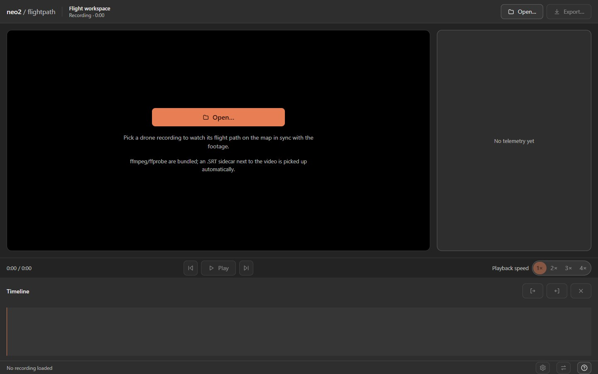
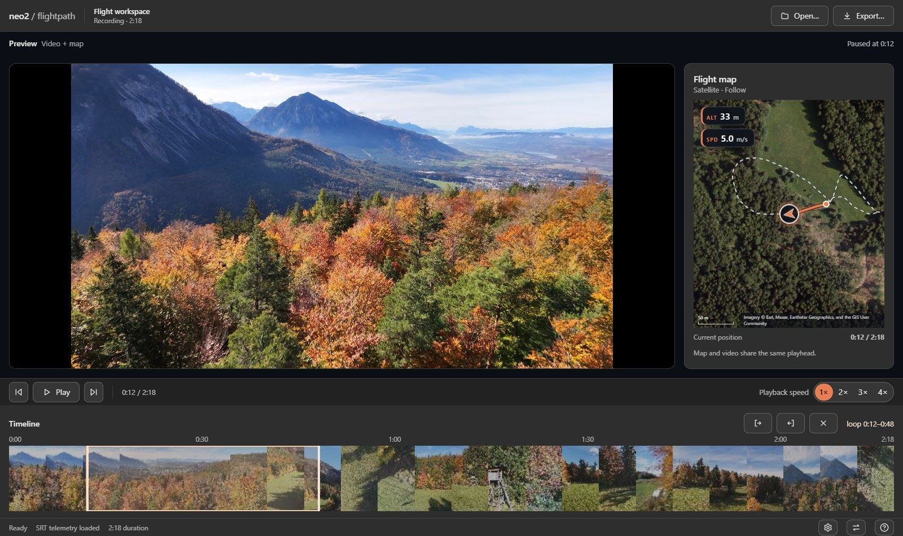
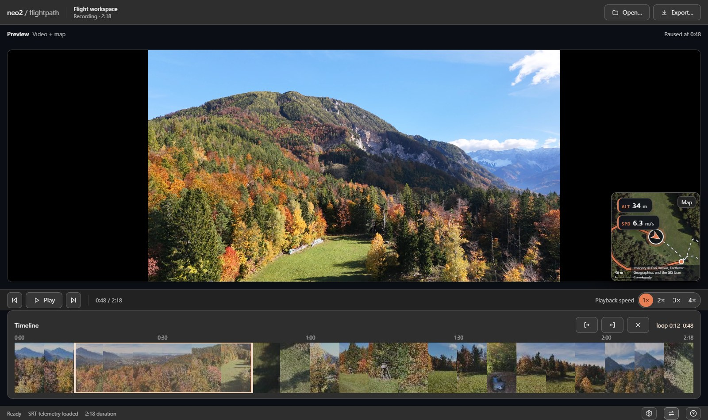
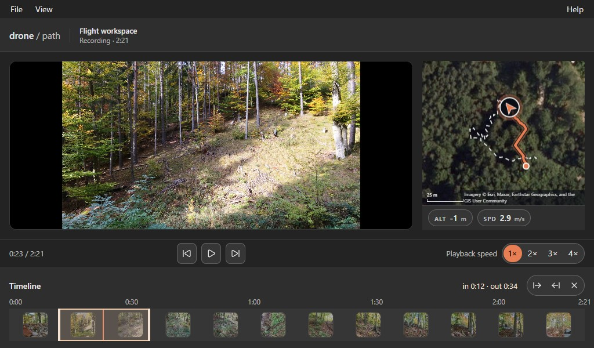
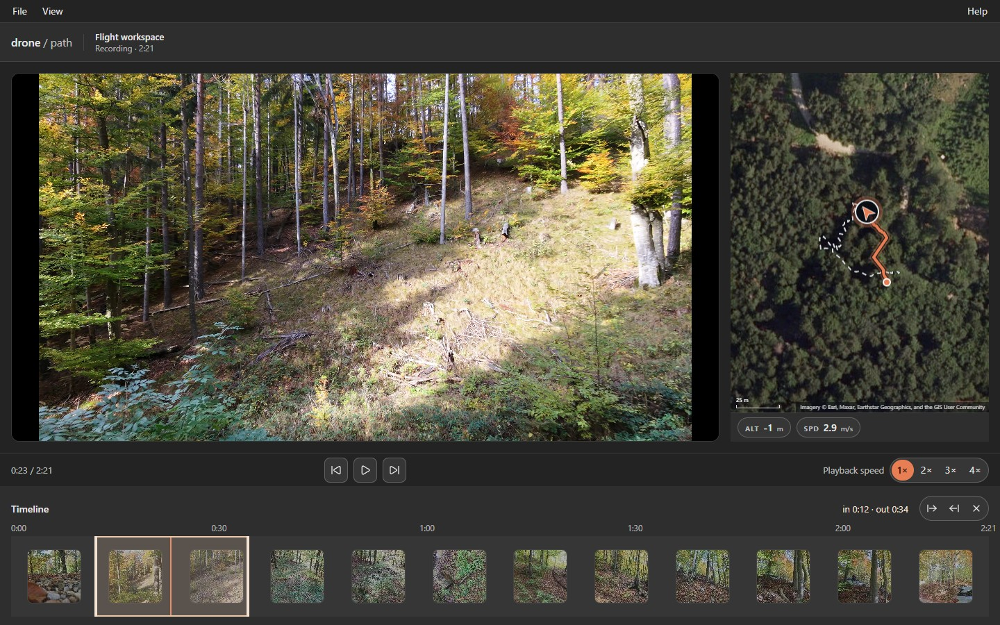
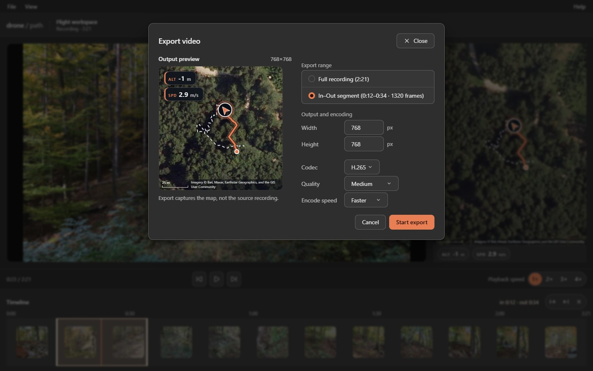
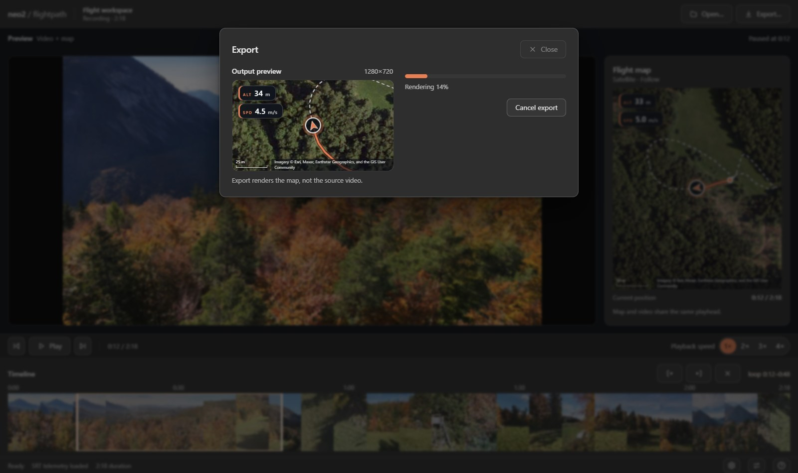
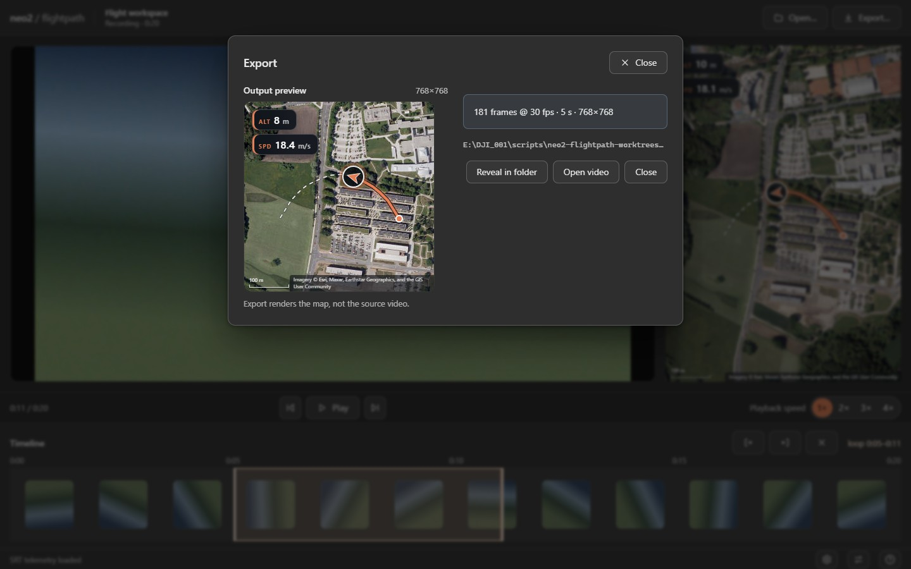
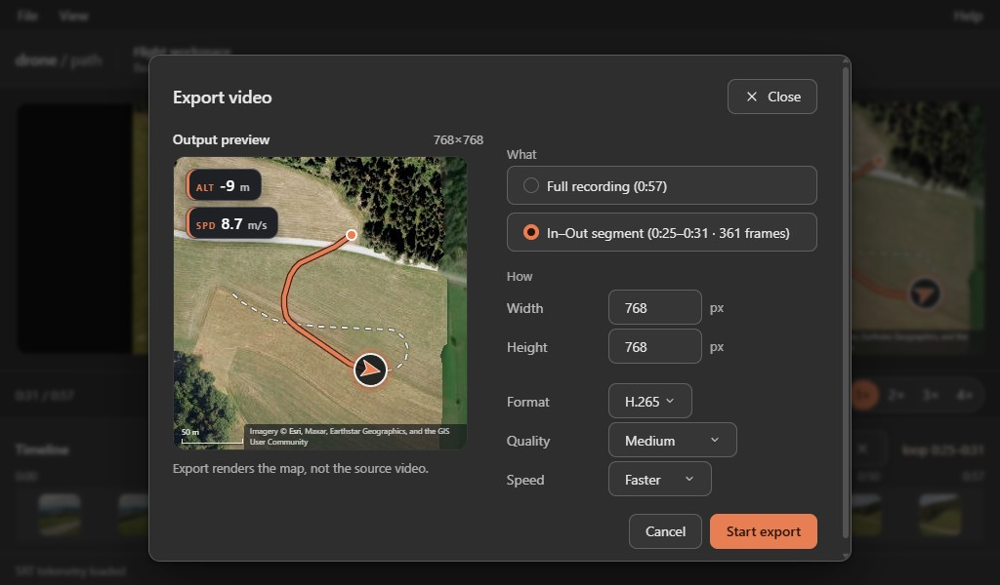
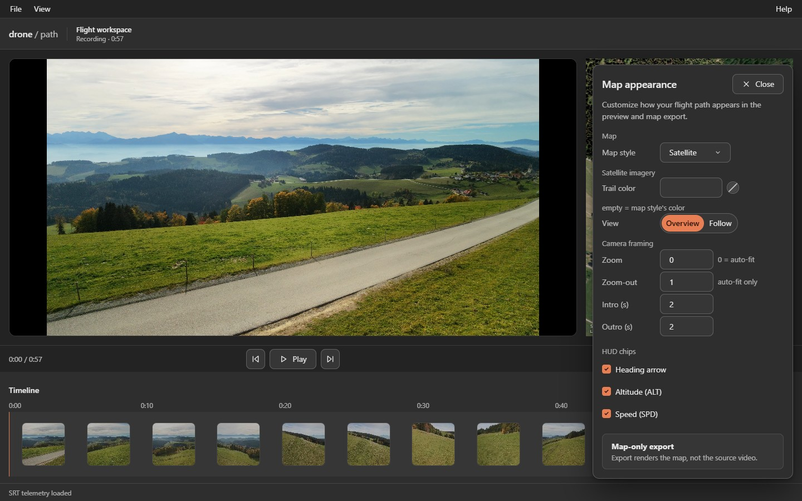

# Desktop app

## Getting the app

Grab the packaged desktop app (Windows NSIS installer or portable exe, Linux AppImage) from [GitHub Releases](https://github.com/MrManny/drone-path/releases), or run `npm run build && npm run app` from a checkout.

## The menu bar

Every command lives in the slim menu bar at the top of the workspace, as in other Windows apps: **File** holds **Open…** (`Ctrl+O`), **Export video…**, **Export telemetry…**, **Settings** and **Exit**; **View** holds **Swap** (`S`); **Help**, at the right edge, holds **Documentation**, which opens this manual, and **About** under a separator. Items that cannot act right now — export, telemetry, Settings and Swap without a loaded recording — sit disabled. The whole menu works with the mouse or the [keyboard](keyboard-shortcuts.md#menu-bar), and `Exit` closes the app, stopping a running export only after a confirmation.

## Loading a recording

Launching the app lands in the review workspace with no recording loaded: the transport, timeline and export menu items sit disabled, and the map pane reads *No telemetry yet*.

To load a recording, use the **Open…** button in the footage pane — **File → Open…** and `Ctrl+O` do the same. The dialog starts in the folder the last recording was opened from.

Picking a drone video opens the player as soon as the recording is probed, its telemetry is loaded and the view is planned — no tile warm-up in between. The map draws the flight trail immediately and loads its tiles on demand, and playback is ready right away. Changing the map style, zoom or view in [Map appearance](#map-appearance) starts loading the tiles for the new view instead.

*The workspace before a recording loads: disabled rows, an **Open…** call to action in the footage pane, and an empty map pane.*

## Reviewing a flight

The review workspace shows the footage and the synchronized flight map at once: the video fills the preview beside the map pane, which keeps the flight trail, drone position and HUD chips and shares the playhead with the video.

**View → Swap** in the menu bar (or `S`) turns the map into a corner overlay on the footage when you want the full frame for the video. Play, pause and scrubbing drive both panes from one timeline, so the map and the footage never drift apart. Every playback control has a [keyboard shortcut](keyboard-shortcuts.md).

*The review workspace: footage and the synchronized flight map side by side, with the timeline below.*

*Swapped view: the flight map overlays the footage while both stay on the same frame.*

At the compact 1024×600 minimum window size the same workspace fits into less space, with every control still in reach.

*The review workspace at the compact 1024×600 window size.*

## Looping a passage

The timeline header holds the loop controls — one button group with **Set loop in (I)**, **Set loop out (O)** and **Clear loop (Esc)** — and a readout of the marked passage. Below it the timeline shows the video as a filmstrip with the loop band over it.

Press `I` to mark the loop in point and `O` the out point. Dragging the band's end handles is a pointer-only way to fine-tune the points; the keyboard path is `I` / `O` and the loop buttons. The marked passage plays on repeat until you clear the loop with `Esc`.

*Loop in and out points marked on the timeline; the passage between them plays on repeat.*

## Export

The **Export video…** item in the File menu is the export entry point; it stays disabled until a recording is loaded. The dialog opens with an **Output preview** beside the form: the preview shows the exact map output — the very scene the export captures, planned at the output size — and states the rule under the frame: *Export renders the map, not the source video.*

With a loop set, the form groups into *What* and *How*:

- *What* — *Full recording* or the *In–Out segment*. Set the loop points with `I` / `O` first; once a loop is set, the segment comes preselected.
- *How* — the output size and the encoding: format (H.264 or H.265), quality (*Near-lossless* down to *Low*) and speed (*Balanced* or *Faster*).

Without a loop, the form just sets size and encoding.

Press **Start export**, pick the destination file, and follow the progress beside the preview until the done state names the rendered output. The app remembers the encoding choices between launches like the look settings, and the output size while the recording is open.

*The Export video dialog: the output preview shows the exact map output beside the What and How form.*

*An export running: the preview freezes on the request while progress reports beside it.*

*Export done: the summary and the output path name the rendered file.*

At the compact 1024×600 minimum window size the preview shrinks and the form stays in reach.

*The Export video dialog at the compact 1024×600 window size.*

## Exporting telemetry

The **Export telemetry…** item in the File menu writes the same per-frame telemetry document as the CLI's `--telemetry-json`, straight from the loaded recording and without rendering anything. One record per source frame covers the time, position, altitude, body and gimbal attitude, heading and camera exposure.

The scope follows the loop points automatically: with a loop set the document covers just the In–Out segment — the same frames the segment export renders, keeping the recording's own frame numbers — and without one the full recording. The item's tooltip states the scope before you choose it.

Choosing it opens the native save dialog, which suggests `<recording>.telemetry.json` in the export folder; cancelling it starts nothing and leaves the workspace untouched. On confirm a compact dialog reports the export and then names the kept file and the scope it covers, with **Reveal in folder** opening its folder. For the same recording and range the file is byte-identical to the CLI output (see [CLI usage](cli.md)).

## Map appearance

The **File → Settings** menu item opens the *Map appearance* popover with the map look settings:

- **Map style** — satellite or topographic.
- **View** — *Overview* shows the whole track at once; *Follow* keeps the drone centered with the map sliding under it.
- **Zoom** — zoom and zoom-out levels, plus the intro and outro zoom transitions.
- **Trail color** — any RGB or RGBA hex color like `#e63946` or `#e63946cc`; leave it empty to keep the map style's own trail color.
- **HUD chips** — heading arrow, altitude (ALT) and speed (SPD). Altitude and speed are off by default, and altitude is unavailable when the telemetry has none.

The panel repeats the rule under the settings: *Export renders the map, not the source video.* Every change applies at once to the preview and the next export. The app remembers these settings between launches: the next launch starts with the last-used look, and a fresh install — or settings the app cannot read — starts at the defaults.

*The map appearance panel: the map look settings live beside the workspace they affect.*

## Updates

Packaged builds update themselves: when a newer [release](https://github.com/MrManny/drone-path/releases) exists, the app downloads it in the background and asks once whether to **Restart now** into it or keep working with **Later**. The update installs when you quit.

## Help

The **Help → Documentation** menu item opens this manual inside the app. It is bundled with the app, so it works offline.

**Help → About** opens a small dialog with the app's identity: the *drone / path* lockup, the installed version below it, the MIT license line and a link to the project repository, which opens in the default browser. The version reads `MAJOR.MINOR.PATCH` in a release build (like `0.8.1`) and adds `+` with the short commit (like `0.8.1+cb40df32`) in every other build, so a support answer names the exact build; release builds never carry the commit suffix.

## Notes

- The app embeds Chromium and needs no system browser; ffmpeg and ffprobe are bundled too — a config file's `ffmpeg`/`ffprobe` keys work like the CLI's flags, and `PATH` remains a fallback.
- Map tiles need internet on the first run and are cached like CLI tiles (see [Tiles and attribution](tiles-and-attribution.md)).
- One recording at a time — batch rendering stays a CLI concern.
