# Desktop app

## Getting the app

Grab the packaged desktop app (Windows NSIS installer or portable exe, Linux AppImage) from [GitHub Releases](https://github.com/MrManny/drone-path/releases), or run `npm run build && npm run app` from a checkout.

## The menu bar

Every command lives in the slim menu bar at the top of the workspace, as in other Windows apps: **File** holds **Open…** (`Ctrl+O`), **Export video…**, **Export telemetry…** and **Exit**; **View** holds **Map appearance…**, **Picture in picture** (`P`) and **Settings…**; **Help**, at the right edge, contains **User manual** and **About**. Items that cannot act right now — export, telemetry and Picture in picture without a loaded recording — sit disabled. The whole menu works with the mouse or the [keyboard](keyboard-shortcuts.md#menu-bar), and `Exit` closes the app, stopping a running export only after a confirmation.

## Changing the app language

Open **View → Settings…** and choose a **Language**. **System default** uses your operating system’s preferred language when it is available, with English as the fallback. An explicit selection takes effect immediately and is saved for the next launch. The offline user manual is available in English.

## Loading a recording

Launching the app lands in the review workspace with no recording loaded: the transport, timeline and export menu items sit disabled, and the map pane reads *No flight path yet*.

To load a recording, use the **Open…** button in the recording pane — **File → Open…** and `Ctrl+O` do the same. The dialog starts in the folder the last recording was opened from.

Picking a drone recording opens the player as soon as the recording is read, its telemetry is loaded and the map is set up — no tile warm-up in between. The map draws the flight trail immediately and loads its tiles on demand, and playback is ready right away. Changing the map style, zoom or view in [Map appearance](#map-appearance) starts loading the tiles for the new view instead.

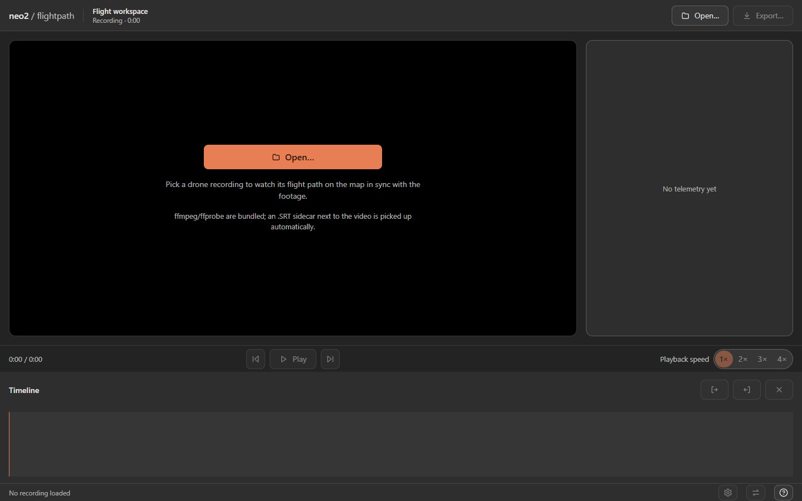

*The workspace before a recording loads: disabled rows, an **Open…** call to action in the recording pane, and an empty map pane.*

## Reviewing a flight

The review workspace shows the recording and the synchronized flight map at once: the recording fills the preview beside the map pane, which keeps the flight trail, drone position and the compact readout strip and shares the playhead with the recording.

**View → Picture in picture** (or `P`) turns the map into a corner overlay on the recording when you want the full frame. Play, pause and scrubbing drive both panes from one timeline, so the map and the recording never drift apart. Every playback control has a [keyboard shortcut](keyboard-shortcuts.md).

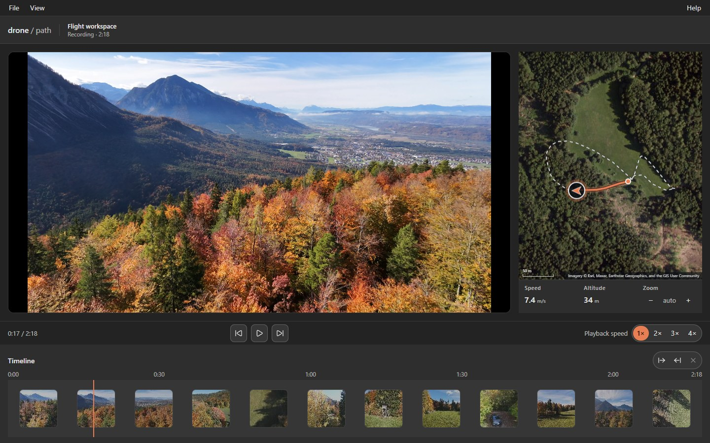

*The review workspace: the recording and the synchronized flight map side by side, with the timeline below.*

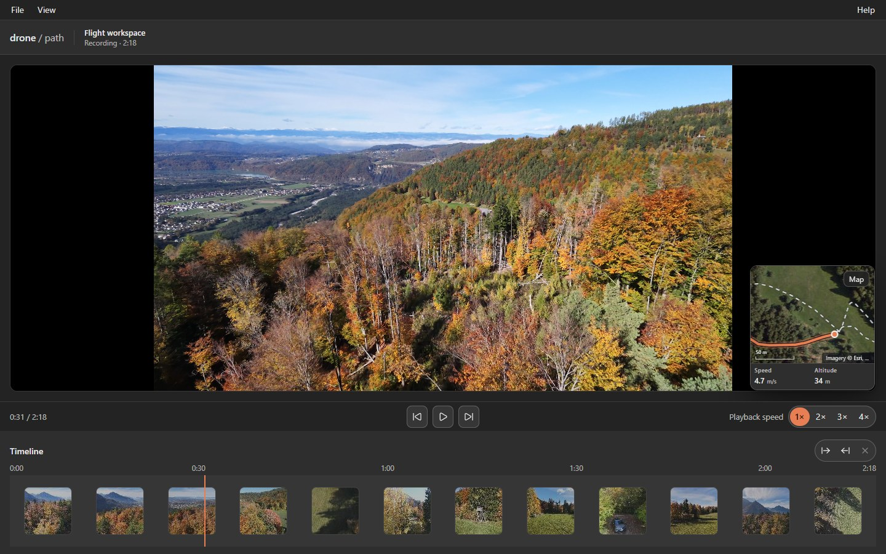

*PiP view: the flight map overlays the recording while both stay on the same frame.*

At the compact 1024×600 minimum window size the same workspace fits into less space, with every control still in reach.

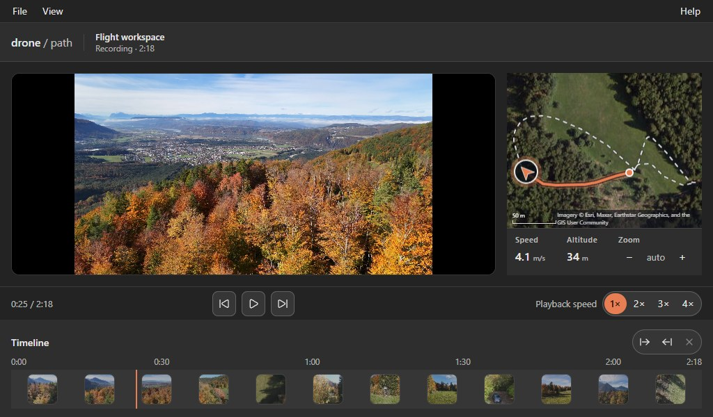

*The review workspace at the compact 1024×600 window size.*

## Marking a passage

The timeline header holds the in/out-point controls — one button group with **Set in point (I)**, **Set out point (O)** and **Clear in and out points (Esc)** — and a readout of the marked passage (`in 0:12 · out 0:34`). Below it the timeline shows the recording as a filmstrip with the In–Out segment over it.

Press `I` to mark the in point and `O` the out point. One point already marks a passage: the in point plays to the end of the recording, the out point from its start, and the readout and the segment show that passage; setting the second point narrows it. Setting a point past the other replaces it — marking an in point beyond an out point clears that out point, and the other way around — so the in point always stays before the out point. Dragging the In–Out segment's edge handles is a pointer-only way to fine-tune the marked points; the keyboard path is `I` / `O` and the in/out-point buttons. The marked passage plays on repeat until you clear the points with `Esc`.

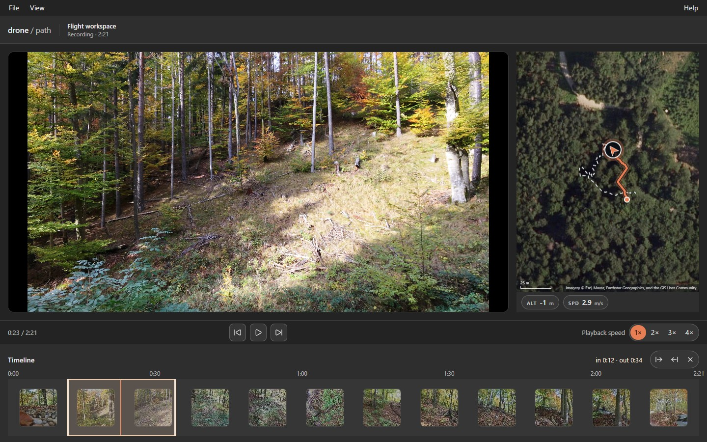

*In and out points marked on the timeline; the passage between them plays on repeat.*

## Export

The **Export video…** item in the File menu is the export entry point; it stays disabled until a recording is loaded. The dialog opens with an **Output preview** beside the form: the preview shows the exact map output — the very scene the export captures, planned at the output size — and states the rule under the frame: *Export captures the map, not the source recording.*

The form groups into *Export range* and *Output and encoding*:

- *Export range* — *Full recording* or the *In–Out segment*. Mark the in or out point with `I` / `O` first; once one is marked, the segment comes preselected — a lone in point exports to the end of the recording, a lone out point from its start.
- *Output and encoding* — the output size and the encoding: codec (H.264 or H.265), quality (*Near-lossless* down to *Low*) and encoding preset (*Balanced* or *Faster*).

Without an In–Out segment, the form just sets size and encoding.

Press **Start export**, pick the destination file, and follow the progress beside the preview until the done state names the exported file. The app remembers the encoding choices between launches like the look settings, and the output size while the recording is open.

Exporting renders the map in a system browser, so Google Chrome or Microsoft Edge must be installed (see [Requirements](getting-started.md#requirements)).

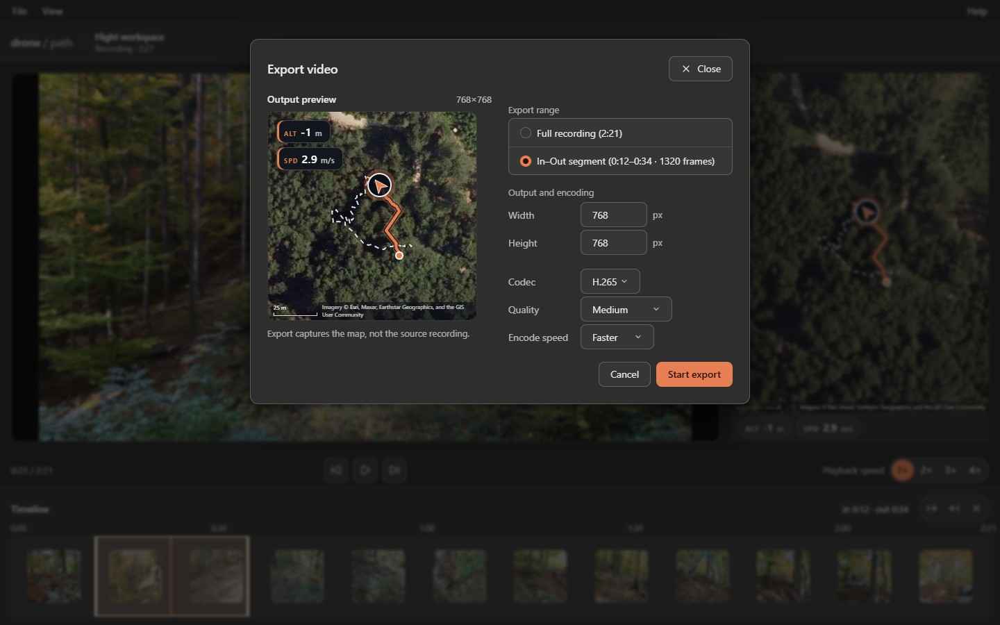

*The Export video dialog: the output preview shows the exact map output beside the export form.*

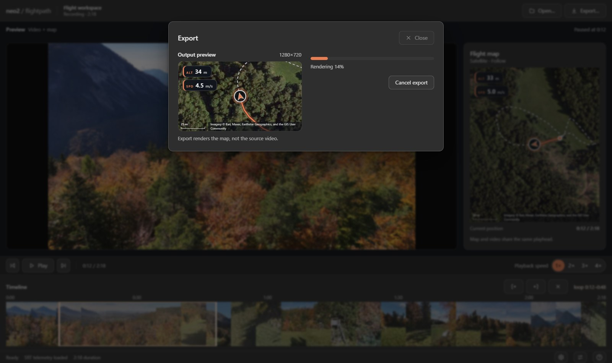

*An export running: the preview freezes on the request while progress reports beside it.*

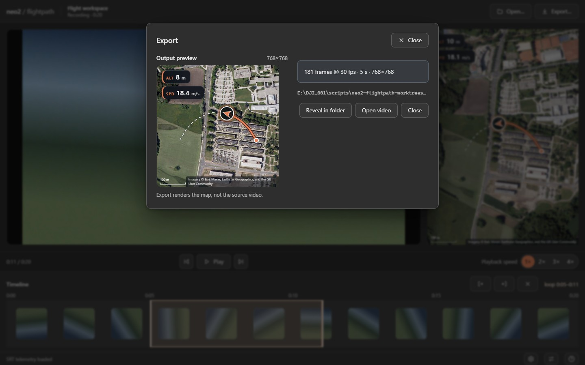

*Export done: the summary and the output path name the exported file.*

At the compact 1024×600 minimum window size the preview shrinks and the form stays in reach.

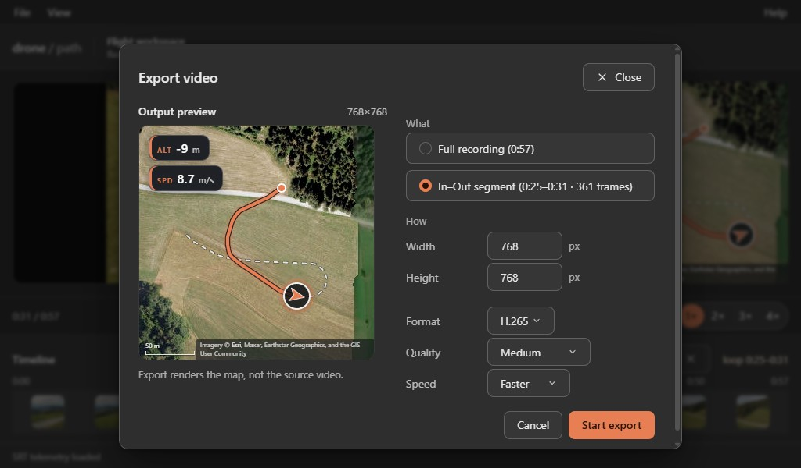

*The Export video dialog at the compact 1024×600 window size.*

## Exporting telemetry

The **Export telemetry…** item in the File menu writes the same per-frame telemetry document as the CLI's `--telemetry-json`, straight from the loaded recording and without producing a video. One record per source frame covers the time, position, altitude, body and gimbal attitude, heading and camera exposure.

The scope follows the in and out points automatically: with the In–Out segment marked — one point is enough — the document covers just those frames, resolved the same way as the segment export (a lone in point to the end of the recording, a lone out point from its start), keeping the recording's own frame numbers, and with no points marked the full recording. The item's tooltip states the scope before you choose it.

Choosing it opens the native save dialog, which suggests `<recording>.telemetry.json` in the export folder; cancelling it starts nothing and leaves the workspace untouched. On confirm a compact dialog reports the export and then names the kept file and the scope it covers, with **Reveal in folder** opening its folder. For the same recording and range the file is byte-identical to the CLI output (see [CLI usage](cli.md)).

The save dialog offers the same five formats as the CLI's `--track-out`: a GPX track (`.gpx`), a GeoJSON track (`.geojson`), a KML or KMZ track (`.kml`, `.kmz`), and the telemetry document (`.json`). The file name picks the format — the typed extension decides what is written, and the suggested `.telemetry.json` name keeps the document the default for a bare name. The track formats carry the flight path itself: vertices at decoded GPS fixes, gaps breaking the line into segments, absolute/GPS altitude in meters above mean sea level, and times only where a recording carries trustworthy UTC (today none does, so a KML track is a plain line per segment). The full field policy lives in [CLI usage](cli.md#flight-track-export).

Every format honors the In–Out range exactly like the telemetry document: with the segment marked the file covers just those frames, and without it the full recording. For the same recording and range the app and the CLI write byte-identical files.

## Map appearance

The **View → Map appearance…** menu item opens the *Map appearance* dialog (it is available with or without a recording, since the look applies to future exports). The dialog is built around a **live preview** of the export frame (16:9) on the left: the real recording when one is loaded, a bundled example flight otherwise, with that state named above the frame. Every change shows in the preview at once, applies to the map and future exports, and persists between launches.

The settings on the right are grouped:

- **Map look** — the map style as two thumbnail tiles (Satellite, Topographic), and the trail color as a swatch row: *Style default* keeps the map style's own trail color; Coral, White and Black pin one of those; **Custom…** reveals a hex field for any RGB or RGBA color like `#e63946` or `#e63946cc`.
- **Camera** — *Overview* shows the whole track at once; *Follow* keeps the drone centered with the map sliding under it. **Auto-fit zoom** frames the flight path automatically: while it is on, the zoom level slider is disabled and shows the level auto-fit resolves to (like *auto-fit → 13*); turning it off pins that level, and the slider sets any whole level from 2 to 19. **Frame padding** pulls the auto-fit camera back that many levels.
- **On-frame readouts** — the Heading, Altitude, and Speed controls. The preview abbreviates these as HDG, ALT, and SPD. Clicking a chip here or over the preview toggles it, and both stay in sync; a turned-off chip shows a dimmed **--**. Altitude and speed are off by default, and the Altitude chip stays off with a text notice when the recording's telemetry has no altitude.
- **Intro & outro** — the structure bar under the preview shows the `[intro | flight | outro]` shape and its segments pick which end of the flight the preview shows. *Intro length* and *Outro length* set how long the camera eases in and out; the hint reads *the camera eases in and out · 0 s disables it*.

**Restore defaults** resets the map look settings to their defaults. Use **Done**, **Close**, or `Esc` to dismiss the dialog. The dialog is modal, so the [player shortcuts](keyboard-shortcuts.md) pause while it is open and keystrokes in a field never reach the player.

Below the flight map in the split view sits one compact strip with three labeled columns: **Speed**, **Altitude** and **Zoom**. The columns are always there — a readout streams live values while its HUD chip is on and shows a dimmed **--** otherwise, including Altitude when the telemetry has none. The bare `−` and `+` buttons around the level step one zoom level and show the level they pinned or *auto-fit* while automatic framing is on. Every step pins that level as the zoom level (the *Zoom level* slider in [Map appearance](#map-appearance)), so the stepper, the slider and the export all show exactly that zoom level, and switching **Auto-fit zoom** back on restores automatic framing. Zooming clamps at the map's usable levels (2 to 19); at either end the matching button dims and says why, and a refused step shows a message beside the readout and is announced. The `+` / `-` [keyboard shortcuts](keyboard-shortcuts.md) do the same from the keyboard, in both views. The PiP overlay keeps every readout — including the zoom level and the announcement of a refused step — but not the `−` and `+` buttons; the keyboard shortcuts still step the zoom there.

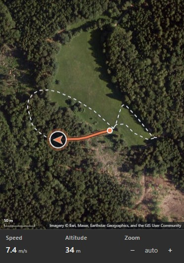

*The compact strip below the flight map: labeled readouts beside the bare zoom stepper.*

Every change applies at once to the preview and the next export. The app remembers these settings between launches: the next launch starts with the last-used look, and a fresh install — or settings the app cannot read — starts at the defaults. Opening a recording resets the zoom to auto-fit regardless of what was remembered.

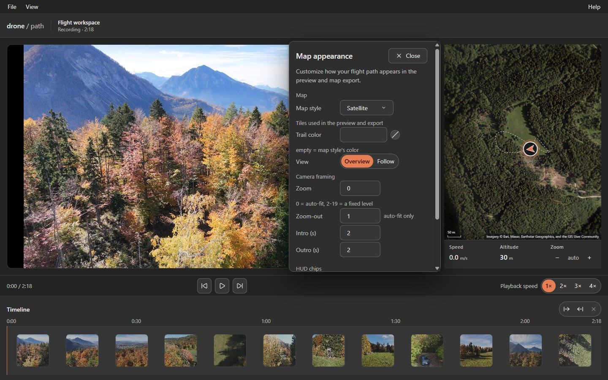

*The Map appearance dialog: the live preview and the intro & outro strip on the left, the grouped settings on the right.*

## Updates

Packaged builds update themselves: when a newer [release](https://github.com/MrManny/drone-path/releases) exists, the app downloads it in the background and asks once whether to **Restart now**. Choose **Later** to keep working and install the update when you quit. Should the restart fail, the dialog says so and the update still installs when you quit.

## Help

**Help → User manual** opens the manual inside the app. It is bundled with the app, so it works offline.

**Help → About** opens a small dialog with the app's identity: the *drone / path* lockup, the installed version below it, the MIT license line and a link to the project repository, which opens in the default browser. The version reads `MAJOR.MINOR.PATCH` in a release build (like `0.8.1`) and adds `+` with the short commit (like `0.8.1+cb40df32`) in every other build, so a support answer names the exact build; release builds never carry the commit suffix.

## Notes

- Video export needs Google Chrome or Microsoft Edge on the system; with neither installed, `npx playwright install chromium` works too (see [Requirements](getting-started.md#requirements)). ffmpeg and ffprobe are bundled — a config file's `ffmpeg`/`ffprobe` keys work like the CLI's flags, and `PATH` remains a fallback.
- Map tiles need internet on the first run and are cached like CLI tiles (see [Tiles and attribution](tiles-and-attribution.md)).
- One recording at a time — batch rendering stays a CLI concern.
