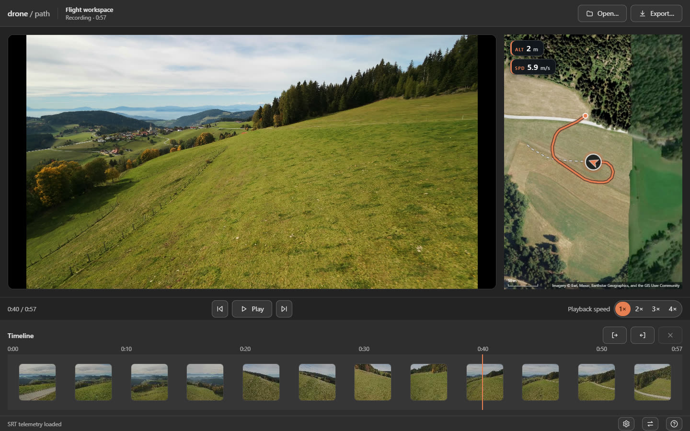

# Getting started

## What it does

neo2-flightpath renders flight-path map-overlay videos from DJI drone recordings (the DJI Neo 2 and similar) at exactly the source frame rate and frame count. Telemetry comes from the `.SRT` sidecar when one is available, otherwise from the embedded CAM-meta (DVTM) stream.



*The desktop app playing a recording: footage and map overlay in picture-in-picture, with the flight trail, drone position and HUD chips on one shared timeline scrubber.*

## Getting it

Run it straight from npm with `npx neo2-flightpath`, or straight from GitHub with `npx github:MrManny/neo2-flightpath`. To work from a checkout instead, clone the repository and run `npm ci`.

## Requirements

- **Node.js >= 24**
- **ffmpeg + ffprobe** on `PATH` (telemetry extraction and video encoding): `winget install Gyan.FFmpeg` on Windows, `brew install ffmpeg` on macOS, `apt install ffmpeg` on Linux.
- **Google Chrome or Microsoft Edge** for rendering from the CLI. The desktop app embeds Chromium and needs no system browser. With neither browser installed, `npx playwright install chromium` works too, and any Chromium executable can be forced with `--browser <path>`.
- **Internet on the first run**: map tiles are fetched and then cached permanently (see [Tiles and attribution](tiles-and-attribution.md)).

## Quick start

```sh
# from GitHub
npx github:MrManny/neo2-flightpath "my-flight.mp4"

# from npm
npx neo2-flightpath "my-flight.mp4"

# topographic map, altitude + speed HUD
npx neo2-flightpath "my-flight.mp4" --style topo --hud heading,alt,speed
```

Output lands in the `out/` folder as `<basename>_map.mp4`; both the folder and the name are configurable. For inputs and options in depth, see [CLI usage](cli.md).

## Where to go next

- [Desktop app](desktop-app.md) — reviewing flights and exporting video from the app.
- [CLI usage](cli.md) — inputs, examples, and example output.
